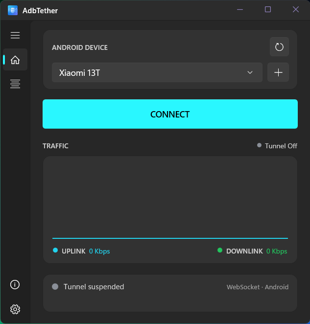
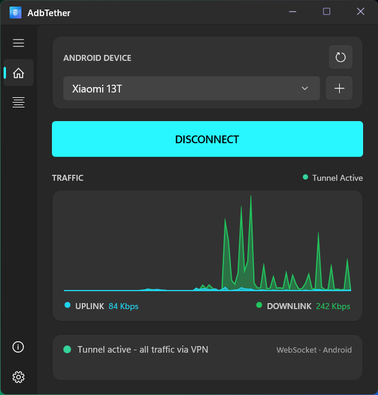

#  AdbTether

**Share an Android phone's internet connection with a Windows PC.**

AdbTether routes the PC's full L3 traffic (TCP + UDP) through an Android phone over
a WebSocket tunnel — no root required on the phone, and no proxy app needed on
the PC. It installs a Wintun virtual adapter and drives a user-space TCP/IP
stack; a small Rust proxy (`ws-proxy`) runs on the phone side and is reached
through `adb forward`.

| Tunnel off | Tunnel active |
|---|---|
|  |  |

## Requirements

The MSI is a framework-dependent build: it does not bundle the .NET or
Windows App SDK runtimes.

- Windows 10 1809 or newer, or Windows 11 (x64)
- [.NET 10 Runtime (x64)](https://dotnet.microsoft.com/download/dotnet/10.0)
- [Windows App Runtime 1.8 (x64)](https://learn.microsoft.com/windows/apps/windows-app-sdk/downloads)
- An Android device with USB debugging or wireless debugging enabled, authorised
  for ADB

`adb.exe` (Android SDK Platform-Tools 36.0.2) ships in the app folder, so a
separate Platform-Tools install is not required.

Setup checks for 64-bit Windows 10 version 1809 (build 17763) or newer and
for the .NET 10 Runtime, and stops with a message if either is missing, so a
fresh install cannot leave the service failing with **error 1053**. Install the
Windows App Runtime before launching AdbTether; the UI checks it at startup and
does not launch without it.

## Goals

- **Tether over ADB.** Share the phone's connection with the PC using only the
  existing ADB link — no root, and no proxy app needed on the PC.
- **No app on the phone.** Nothing is installed on the Android device;
  `ws-proxy` is pushed and run over ADB on demand.
- **Survives Android power management.** The phone-side proxy is not subject
  to battery-optimization throttling or to the system freezing it in the
  background.
- **Reaches the phone's VPN.** Traffic egresses through whatever network the
  device is on, including a VPN active on the phone.

```
┌───────────────────────────────────────────────────────────────┐
│  [WinUI 3 UI]  ──RPC──►  [AdbTetherService (SYSTEM)]  ──FFI──►│
│  device / settings        RPC: 127.0.0.1:47012                │
│                                                               │
│                          [AdbTether_core.dll]                 │
│                           wintun adapter "AdbTether"          │
│                           smoltcp + WebSocket client          │
│                                    │                          │
│                       WebSocket (adb forward tcp:1092)        │
│                                    ▼                          │
│                       [ws-proxy running on the phone]         │
│                                    ▼                          │
│                       phone's network ──► Internet            │
└───────────────────────────────────────────────────────────────┘
```

## Tunnel lifecycle

| Event | Effect on the PC's network |
|---|---|
| **Connect** | Routes, pinned DNS and the adapter IP are installed; all TCP/UDP goes through the phone. |
| **Disconnect** (button) | Default route, DNS pinning, IPv6 kill-switch and exclusions are removed. The adapter and its IP are kept, so reconnecting resumes instantly. |
| **Connection lost** (ws-proxy dies) | Fail-closed: the PC **stays on the tunnel** with no connectivity (routes and DNS stay put) until you press Disconnect. Traffic never silently falls back to the physical network. |
| **App closed** | The service notices its last client gone and leaves the tunnel completely — routes, DNS and the adapter IP are removed, so the PC returns to its normal network. The adapter is kept for a fast next connect. |

## Components

| Component | Path | Language | Output |
|---|---|---|---|
| Tunnel engine | `crates/engine` | Rust | `AdbTether_core.dll` (cdylib) |
| Windows service | `src/AdbTetherService` | C# (.NET 10) | `AdbTetherService.exe` (SYSTEM) |
| Desktop UI | `src/AdbTether` | C# (WinUI 3) | `AdbTether.exe` |
| Phone-side proxy | `crates/ws-proxy` | Rust | `ws-proxy` (aarch64-linux-android) |
| Installer | `installer` | WiX 6+ | `AdbTether.msi` |

## Repository layout

```
AdbTether/
├── Cargo.toml                    # Rust workspace (engine + ws-proxy)
├── rust-toolchain.toml
├── .cargo/config.toml            # repo-local target dir
├── AdbTether.slnx                   # VS solution (UI + service)
├── build.ps1                     # one-shot build
├── test.ps1                      # test runner (cargo + live leak checks)
├── crates/
│   ├── engine/                   # Rust tunnel engine -> AdbTether_core.dll
│   └── ws-proxy/                 # Rust phone-side WebSocket proxy
├── src/
│   ├── AdbTether/                   # WinUI 3 desktop app
│   └── AdbTetherService/            # Windows service
├── tests/
│   ├── README.md                 # test map
│   └── leak/Test-Leaks.ps1       # live DNS / IPv6 / WebRTC leak checks
├── tools/                        # dev helpers (deploy-engine.ps1)
├── installer/                    # WiX MSI (Product + generated fragments)
└── docs/
```

## Build prerequisites

| Tool | Version | Notes |
|---|---|---|
| Rust | 1.93+ | `rust-toolchain.toml` pins it |
| VS Build Tools | 2022+ | MSVC linker ("Desktop development with C++") |
| .NET SDK | 10.0 | Service + UI |
| WiX Toolset | 6.0+ | `dotnet tool install --global wix` |
| Android NDK | recent | Only to build `ws-proxy` |
| wintun.dll | — | Vendored at `crates/engine/wintun.dll`; do not delete |

## Build

One-shot build (recommended) — engine, phone-side proxy, service, UI and MSI:

```powershell
./build.ps1                 # full build (Release) incl. MSI
./build.ps1 -SkipAndroid    # skip the phone-side ws-proxy
./build.ps1 -SkipMsi        # skip the installer
./build.ps1 -Configuration Debug
```

`build.ps1` picks one Rust toolchain for everything (so host and Android
artifacts never mix) and auto-locates the Android NDK.

Manual steps:

```powershell
# 1. Rust engine (Windows host) -> target\release\adbtether_core.dll
cargo build --release -p adbtether-engine

# 2. Windows service
dotnet build src/AdbTetherService -c Release

# 3. WinUI 3 desktop app (x64)
dotnet build src/AdbTether -c Release -p:Platform=x64

# 4. Phone-side proxy (cross-compile; needs Android NDK)
powershell -File crates/ws-proxy/run.ps1 -BuildOnly

# 5. MSI
wix build -arch x64 `
  -d "UI=src\AdbTether\bin\x64\Release\net10.0-windows10.0.19041.0" `
  -d "SVC=src\AdbTetherService\bin\Release\net10.0-windows\win-x64" `
  -o installer\dist\AdbTether.msi `
  installer\Product.wxs installer\AppFiles.wxs installer\ServiceFiles.wxs
```

Cargo output always goes to the repo-local `target/` (see `.cargo/config.toml`),
independent of any global `~/.cargo/config.toml`.

### Regenerating the MSI file fragments

`installer/AppFiles.wxs` and `installer/ServiceFiles.wxs` are generated from a
build's payload when its file list changes:

```powershell
powershell -File installer/gen_fragments.ps1 -Source <UI_BIN>  -VarName UI  -Group AppFilesGroup    -DirRef APPDIR     -OutFile installer/AppFiles.wxs    -Prefix AF_
powershell -File installer/gen_fragments.ps1 -Source <SVC_BIN> -VarName SVC -Group ServiceFilesGroup -DirRef SERVICEDIR -OutFile installer/ServiceFiles.wxs -Prefix SV_ -Service
```

## Releasing

See [`docs/RELEASING.md`](docs/RELEASING.md) for the version-bump locations,
the build/verify steps and the code-signing note.

## Testing

```powershell
./test.ps1                      # Rust unit + integration tests
cargo test --workspace          # the same, directly
./test.ps1 -Leaks               # also run live DNS / IPv6 / WebRTC leak checks
```

The Rust tests are self-contained (no device, no admin, no tunnel). They cover
the tunnel engine's packet classification, UDP relay and flow-id demux, the
WebSocket TCP/UDP transports, FFI settings, and — as leak regressions — that
**DNS (UDP/53)**, **STUN/WebRTC** and **mDNS** datagrams are captured and
round-trip intact while IPv6 is kept off the physical link. The phone-side
`ws-proxy` is exercised end to end over a real loopback WebSocket.

`tests/leak/Test-Leaks.ps1` runs against a live system (elevated shell +
raised tunnel) and verifies the adapter's DNS pinning, the IPv6 kill-switch
route and a real STUN egress. It **skips** cleanly when those prerequisites are
absent. See [`tests/README.md`](tests/README.md) for the full map.

## Install / uninstall

```powershell
msiexec /i AdbTether.msi          # GUI
msiexec /i AdbTether.msi /qn      # silent
msiexec /x AdbTether.msi /qn      # silent uninstall
```

For development you can run the service in console mode instead of installing it:

```powershell
src\AdbTetherService\bin\Debug\net10.0-windows\win-x64\AdbTetherService.exe
```

## Identity

| Item | Value |
|---|---|
| Service | `AdbTetherService` (RPC `127.0.0.1:47012`) |
| Install dir | `AdbTether` |
| Registry | `Software\AdbTether` |
| Wintun adapter | `AdbTether` |
| MSI UpgradeCode | `{376E0119-4DE5-4D21-A82B-E5EFA9785F8D}` (stable across releases) |

## Privacy

AdbTether has no telemetry, no analytics and no accounts. See
[`PRIVACY.md`](PRIVACY.md) for every file it writes and the one
network request it makes.

## License

MIT - see [LICENSE](LICENSE).
